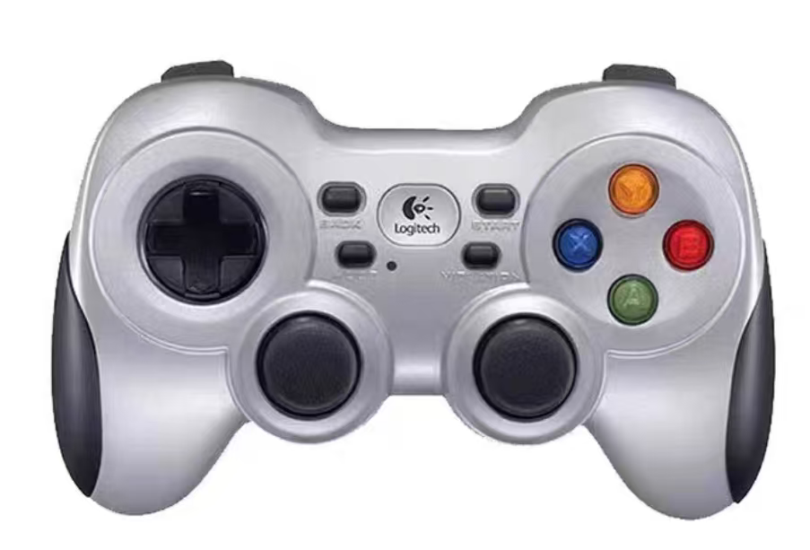
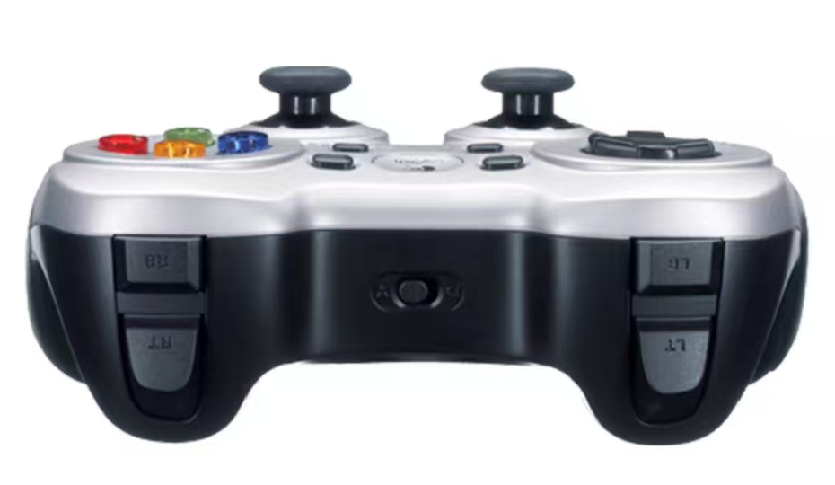
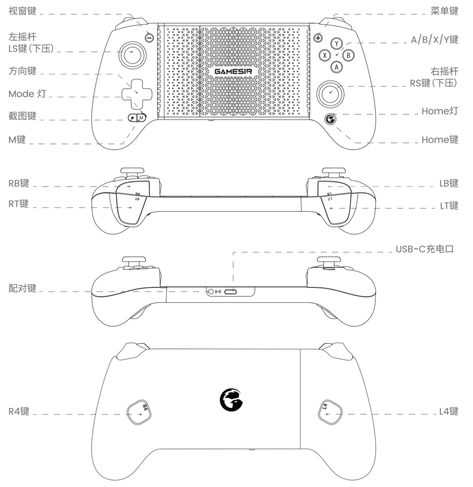
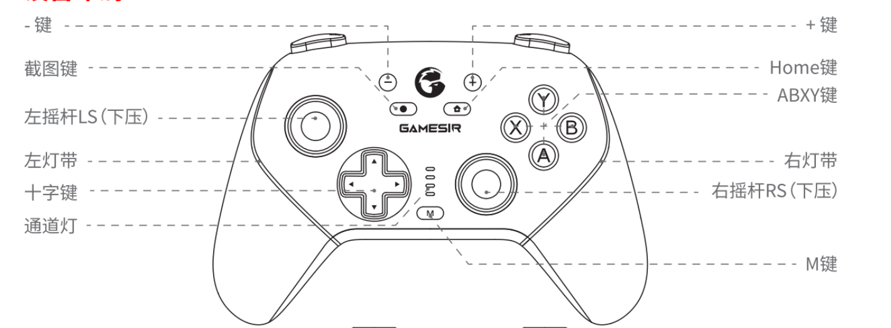
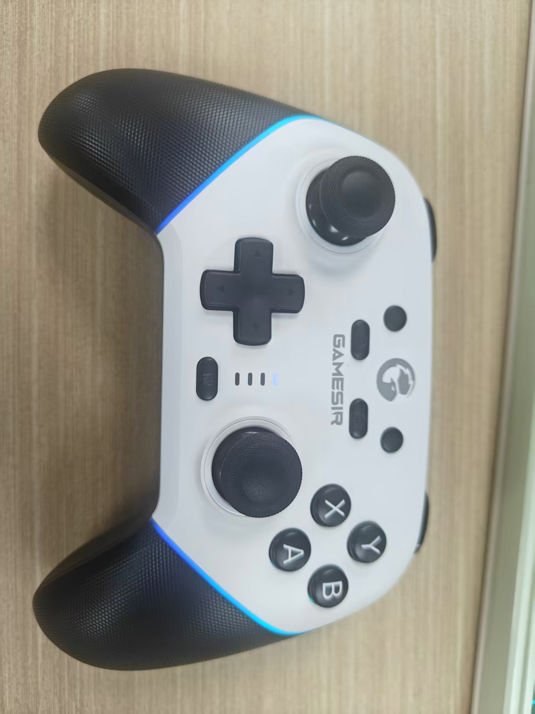
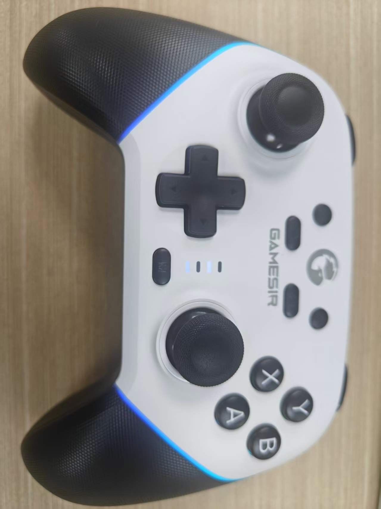
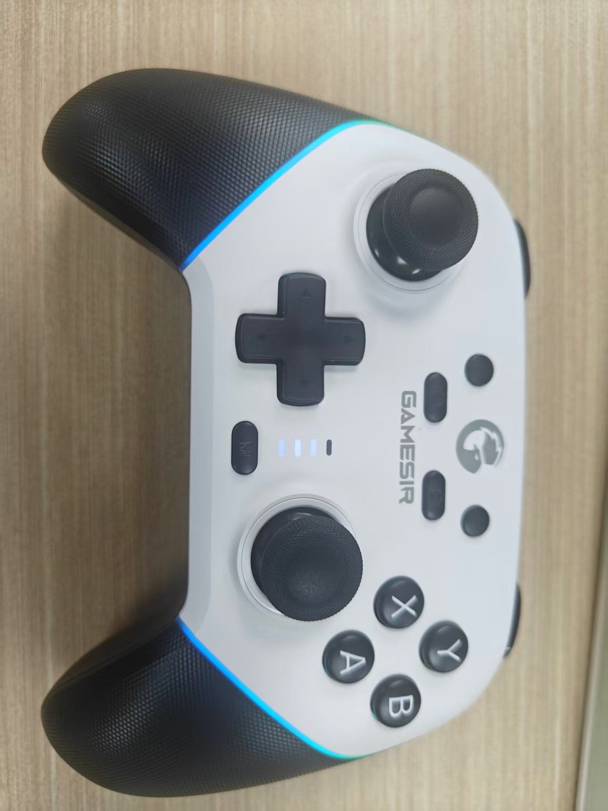

# Joystick teleop

A game controller (joystick / gamepad) commands the arms and, in chassis mode, the mobile base. The node is `joystick_teleop` in [`arms_teleop`](https://github.com/fiveages-sim/arms_ros2_control/blob/main/command/arms_teleop/README.md) ([arms_ros2_control](https://github.com/fiveages-sim/arms_ros2_control)).

## 1. Before you start

- The robot stack is already running (mock, Isaac Sim, or real). This launch starts the joystick node on that stack.
- The controller is on `/dev/input/js0`, unless you pass another `joy_dev`.

## 2. Start

:::{code-block} bash
source install/setup.bash
ros2 launch arms_teleop joystick_teleop.launch.py
:::

`joy_driver:=auto` picks the driver from `ros2 run joy joy_enumerate_devices`. When that report says `Mapped: true`, the launch uses `game_controller_node` and [`generic_gamepad.yaml`](https://github.com/fiveages-sim/arms_ros2_control/blob/main/command/arms_teleop/config/joy_mapping/generic_gamepad.yaml) (SDL layout: F710, PS4, Xbox, Switch Pro, GameSir). An unmapped device uses `joy_node` and `default.yaml`.

:::{code-block} bash
ros2 run joy joy_enumerate_devices
ros2 launch arms_teleop joystick_teleop.launch.py joy_dev:=/dev/input/js1
ros2 launch arms_teleop joystick_teleop.launch.py joy_driver:=joy
ros2 launch arms_teleop joystick_teleop.launch.py config:=default joy_driver:=joy
:::

| Argument | Default | What it selects |
|----------|---------|-----------------|
| `joy_driver` | `auto` | `auto`, `game_controller`, or `joy` |
| `joy_dev` | `/dev/input/js0` | Device path (`/dev/input/jsN`). With several controllers, pass this and the launch enumerates that id |
| `config` | `auto` | File name under `config/joy_mapping/` (no suffix), or `auto` |

`config:=auto` follows the same mapped / unmapped split: `generic_gamepad` or `default`. On an F710, X and D share `generic_gamepad.yaml` under `game_controller_node`. With `joy_driver:=joy`, use `default.yaml` and restart the launch after you flip the mode switch.

For an unmapped device, echo `/joy`, note the button and axis indices, and add a YAML under `config/joy_mapping/`. Start with `config:=<name>`.

On a lean branch, the `quick_start.sh` assist menu can start this launch. One controller starts on its own; several controllers ask for the device id and pass `joy_dev`.

Leave `keyboard_teleop` stopped while `joystick_teleop` is publishing `control_input` and `/cmd_vel`. Both nodes write those topics.

## 3. Controllers we have checked

Three controllers have been tried on X86, Jetson Thor, and RK3588. The names in the table are the ones from that check.

| Controller | X86 | Jetson Thor | RK3588 |
|------------|-----|-------------|--------|
| 罗技 F710 | Both X-input and D-input | X-input only | D-input only |
| 小鸡手机支架版本 | Supported | Supported | Supported |
| 小鸡超新星（灵猴二代底盘自带） | Every mode except Switch | Every mode except Switch | PS4 mode only |

### 3.1 罗技 F710

The F710 connects over 2.4G. The receiver sits in the shell on the back. X86 accepts both switch positions. Jetson Thor uses X-input. RK3588 uses D-input.

Under `game_controller_node`, X and D share `generic_gamepad.yaml`. With `joy_driver:=joy`, use `default.yaml` and restart the launch after you flip the switch. That split is in the [package README](https://github.com/fiveages-sim/arms_ros2_control/blob/main/command/arms_teleop/README.md).





### 3.2 小鸡手机支架版本

For a quick link, use 2.4G. Plug in the receiver, then press **X** and the screenshot key together. A blue Home light means it is connected. Other modes are in the [G8+ guide](https://doc.xiaoji.com/zh/g8+/detail/1504.html).



### 3.3 小鸡超新星

This controller comes with the 灵猴二代 chassis. Turn it on from the back, select 2.4G, plug in USB, and press Home. Hold **−** and **+** together to change the radio mode.

Use Xbox mode. Switch mode uses a different button map, so leave it off. On RK3588 the check passed only in PS4 mode. On X86 and Jetson Thor every mode except Switch passed. Pairing steps are in the [Nova Pro guide](https://doc.xiaoji.com/zh/nova-pro/).

On this drawing, **−** is the Back key and **+** is Start. The button table below uses those names from the package README.



The channel lights sit on the front, beside the M key. The check marks the pattern with four blue lights as Xbox mode.







## 4. Buttons

Teleop starts disabled. Press the **right stick** to enable it, then move the sticks. Press the right stick again to disable.

| Control | What it does |
|---------|----------------|
| **RB** | ARM ↔ CHASSIS |
| **Back** | Mirror on or off |
| **Left stick** click | High / low speed |
| **A** | Switch the active arm (arm mode) |
| **X** | Gripper open / close |
| **LT** / **RT** | Gripper open ratio |
| **LB** + **A** | FSM HOME |
| **LB** + **B** | FSM HOLD |
| **LB** + **Y** | FSM MOVEJ |
| **LB** + **START** | FSM OCS2 |

Hold **LB** for the FSM chords. The node log prints this map at startup. Extra ROS parameters (`mirror_movement`, `speed.*`, `chassis.*`, `button_mapping.*`, `axes_mapping.*`) come from the mapping YAML.

## 5. Keyboard

`keyboard_teleop` uses the same `control_input` and `teleop_mode` contract. Run it in its own terminal so stdin is a real TTY:

:::{code-block} bash
ros2 run arms_teleop keyboard_teleop
:::

The key map (WASD, arm / chassis, mirror, speed, gripper) is [section 4 of the package README](https://github.com/fiveages-sim/arms_ros2_control/blob/main/command/arms_teleop/README.md). `/fsm_command` comes from the joystick. The same `quick_start.sh` assist menu has a keyboard entry, and that entry takes the current terminal.

## 6. What you should see

After the right-stick enable, stick motion moves the active arm, or the chassis in chassis mode. `teleop_mode.active` is true after that enable. On the keyboard it is already true.

### 6.1 Control-input HUD

With the joystick running, RViz shows one teleop card at the top left of the 3D view. That card is `TeleopMode` plus the active arm: `ARM` `L` or `R` (`Inputs.target`), `MIRROR` for `mirror_movement`, and `SPD` `LOW`/`HIGH` for `speed_level`. On the card, `R` is orange, `L` is blue, `MIRROR ON` is gold, `MIRROR OFF` is muted, `SPD HIGH` is gold, and `SPD LOW` is blue.

The clip is a FiveAges W2 in `fullbody.rviz`. The card moves between the right arm and the left arm, turns mirror on and off, and steps speed between low and high. When the FSM enters OCS2, the FSM panel, joint panel, and MPC readout appear beside it.

```{raw} html
<video controls preload="metadata" width="100%">
  <source src="../../_static/videos/joystick-rviz-hud.mp4" type="video/mp4">
</video>
```

## 7. Topics

The joystick publishes `control_input` (`arms_ros2_control_msgs/Inputs`), `teleop_mode` (`arms_ros2_control_msgs/TeleopMode`), `/cmd_vel` in chassis mode, the waist commands, and `/fsm_command`. `arms_target_manager` turns `control_input` into `left_target/twist` and `right_target/twist`.

Field names, types, and QoS for `teleop_mode` and `control_input` are on {ref}`Teleop topics and data <teleop-topics-and-data>`. Headset, foot pedal, and exoskeleton mode fields are on that same page.

(foot-pedal-assist-only)=
## 8. Foot pedal

`foot_pedal_teleop` is an assist next to the joystick or the keyboard. It reads one USB pedal (the packaged udev rule is for the SayoDevice CM6K) and publishes event codes on the relative topic `teleop/controller_state` (`std_msgs/Int32`). `VRInputHandler` applies those events and publishes the current mode on `teleop/mode_state` (`TeleopModeState`).

Run the pedal in the same namespace as that robot’s `arms_target_manager`:

:::{code-block} bash
ros2 run arms_teleop foot_pedal_teleop --ros-args -r __ns:=/robot_a
ros2 topic echo /robot_a/teleop/mode_state
:::

With one supported pedal and an empty namespace, `ros2 run arms_teleop foot_pedal_teleop` is enough; the status topic is then `/teleop/mode_state`. The event map (FSM up/down, left/right arm teleop, STORAGE/UPDATE, mirror), udev, and how to pick a device when several pedals are connected are in the [package README](https://github.com/fiveages-sim/arms_ros2_control/blob/main/command/arms_teleop/README.md). Mode fields are on {ref}`Teleop topics and data <teleop-topics-and-data>`.

## 9. Related

- [VR Teleoperation](6-vr_teleop.md) — headset and VR controllers for end-effector pose
- [arms_teleop README](https://github.com/fiveages-sim/arms_ros2_control/blob/main/command/arms_teleop/README.md)
- [FSM and Topics](../../3-concepts/4-fsm_and_topics.md)
