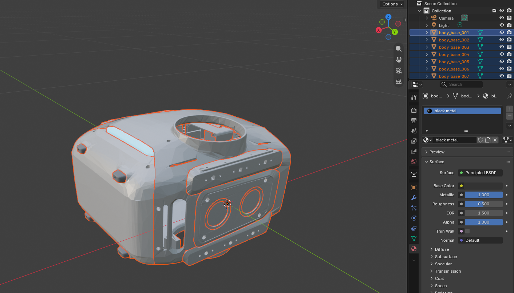
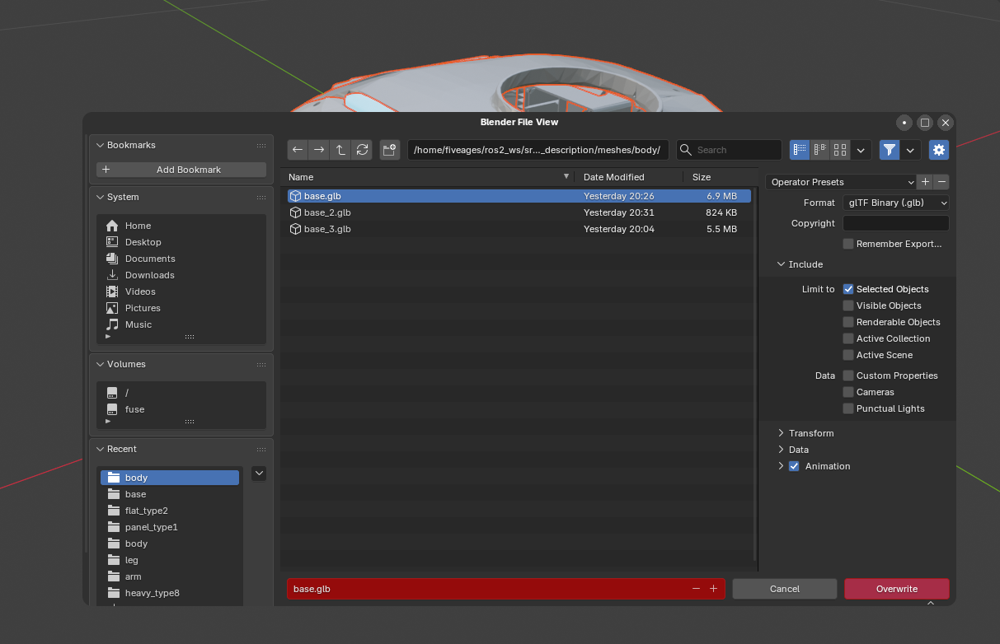

# Robot Asset Onboarding Checklist

This checklist is for an intern bringing a robot asset in for the first time. Run a similar robot that is already here, and get used to what a normal result looks like. Then follow this checklist to bring the new robot into the existing repositories under the company conventions, and leave the verified shared parts for later robots to reuse. It covers arms, mobile bases, dual-arm robots, and humanoids.

The work follows three chapters. Chapter 1 finishes the description package: source material, meshes, Xacro assembly, and the RViz preview. Chapter 2 configures ros2_control and OCS2, and signs off in Mock. Chapter 3 imports the robot into Isaac Sim and closes the loop between commands and feedback. Before a chapter starts on the new robot, run that chapter’s steps on a similar existing robot and use the result as the reference. At the end of each chapter, record the evidence and the handoff for that stage. Splitting meshes and assigning colors has to be done by hand in the Blender UI. The other steps can use a skill for help, and you still check them against this list. The skills you can consult are at the end.

## 1. Description package: configuration, split, and modularization

This chapter finishes the description package itself: upstream material and reuse, mesh cleanup, Xacro assembly, and the static display and joint preview in RViz.

- [ ] Before starting the description package for this robot, open a robot with a similar structure and purpose in RViz. Look at the whole-robot display and the joint preview, and use that as the reference.

### 1.1 Upstream material and repository roles

Look at how a similar existing robot is put together, then measure the parameters of this robot.

- [ ] Check the local workspace, the remote development branches, and the related submodules together, and decide whether a candidate model is already in the tree. Looking only at the current directory misses remote assets.

- [ ] Keep these apart: the vendor product page, CAD pictures that are only for browsing, a downloadable model, a complete robot description package, and an asset that can be simulated directly.

- [ ] From the scope of this delivery, list the parts you need, such as the base, the joint chain, the end effector, and the sensors. Confirm the upstream material for each one.

- [ ] Check the license, the upstream copyright, and the terms on third-party material. Keep the attribution and license text that the terms require. An existing company package is a layout reference. The license text follows the actual source of the asset.

- [ ] Record the exact source and version of every reused part. When a part is reused across models, check the mesh, the mount interface, and the license, and say why it is reused in the README.

- [ ] Put the work in the right repository and branch. The description package holds the Xacro, the meshes, and the controller configuration. The FaSim `robots` submodule holds the robot USD. The FaSim main repository holds the simulation entry points and the project configuration. Vendor upstream material stays in the working copy. Delivered assets go in the matching repository. A local clone can use a different folder name. Follow the role of the repository and the directory convention inside the package. Category and vendor directory names do not have to match between the description package and the USD. Take the path from an existing asset of similar structure in that repository.

### 1.2 Modular layout and reuse

A modular layout organizes the whole robot by how it is assembled, how it moves, and what can be reused. When you divide it, look at whether a part moves on its own, whether it is mounted or replaced on its own, and whether another robot might reference it.

In the company robot-asset repositories, each new robot can leave parts the next one can use directly. Put a new part in the company-shared directory, the series-shared directory, or the robot directory, according to where it is used, and record the source, the coordinate frame, and the mount interface. The same part can then be referenced by more than one robot, and a fix has a clear place to maintain.

- [ ] Look first in the company `common` tree, in description packages of the same series, and in shared FaSim USD. Record the asset path of each candidate. Pay particular attention to grippers and sensors. Check the mount interface, the coordinate frame, and where the part applies, then decide whether to reference it as it is, reference it with a mount transform, or add a new shared part.

### 1.3 Description package layout

- [ ] In the description repository, find a robot with a similar structure and purpose and record its directory path. The FaSim robot directory is planned in Chapter 3. Category and vendor names there can differ from the description package. A description package follows this layout:

:::{code-block} text
<category>/<vendor>/[series/]/<robot>_description/
├── CMakeLists.txt         # files and directories this package installs
├── package.xml            # ROS 2 package name and dependencies
├── README.md              # build, preview, and usage
├── xacro/
│   ├── robot.xacro        # whole-robot assembly entry
│   ├── components/        # base, arm, end effector, and other components
│   └── ros2_control/      # hardware backends and joint interfaces
├── meshes/                # meshes this package maintains, grouped by part
└── config/
    ├── ros2_control/      # controller configuration
    ├── ocs2/              # task and target configuration when OCS2 is used
    └── rviz/              # RViz configuration shipped with the package
:::

`<category>`, `<vendor>`, and `[series/]` stand for the category, the vendor, and the optional series level. The top-level path follows the convention of the description repository you are in. `[series/]` is optional and follows that convention. Use the directories this robot and this delivery need. An existing shared mesh is referenced from the assembly entry or from the matching component. This robot defines the mount pose.

### 1.4 Split and reassembly

The first time you bring in a description package and the meshes need cleanup, you split the parts yourself in the Blender UI, and you select and isolate objects or faces yourself. Export, then import again and check. The other steps can use a skill for help, but you still open the model and judge it, and you check it against this list. A model that already works does not have to be split apart and rebuilt.

- [ ] Import the vendor’s original STL, or the other source mesh, and keep a copy to compare. When a broken triangle is already in the upstream mesh, tell a normal-display problem apart from missing geometry.

- [ ] For every part, check it yourself in the Blender UI, in face select mode, and separate loose parts. Use the Outliner or an isolated view, open the model, and confirm the objects you split out are really there.

This is a part after it has been split into loose pieces in Blender. Several named objects are selected together, and each one can be checked in the Outliner.

- [ ] Keep shells, panels, light strips, wheel modules, leveling feet, and anything else that has a role in the assembly. Merge small bolts, nuts, and washers that have no role of their own into the component they belong to, so you do not keep a pile of meaningless fragments.

- [ ] Name mesh objects by what the part is for, including the lower-level pieces split out of it, and tidy the numbering.

- [ ] Export one GLB for each reusable part. One GLB can hold several named objects. In the export dialog, set Format to glTF Binary (glb), and turn on Limit to Selected Objects, so the file contains only the objects that are selected now. Import it back into Blender and confirm the objects were not fused into one.

This is the export dialog with Limit to Selected Objects turned on.

- [ ] For repeated parts on the same robot, compare geometry, material, and coordinates first. Left and right arms, grippers, wheels, legs, and leveling feet can be reused with a rigid transform, or with a mirror you have checked. When the triangulation differs, judge by the surface deviation after the parts are registered.

- [ ] A repeated kinematic chain can share one component macro. Use `prefix` to tell the instances apart, and to tell their link and joint names apart. Mirror the mesh with the `direction` parameter. Mount pose, the real inertia on each side, and the limits are still given per side. After expansion, check joint direction, end position, inertia, and joint axis on each side.

- [ ] Compare wheel modules, mounts, adapter plates, leveling feet, and knobs. When the fixed relationship is the same, take out one subassembly and mount it again in Xacro at the real pose of each mount point. One GLB that holds several named objects can be referenced the same way.

- [ ] Use one convention for mesh coordinates, units, origin, and axes. Check XYZ on the mesh after the transform, so a GLB axis conversion or a node transform does not leave a part looking as if it turned 90°.

- [ ] When the source asset is OBJ, confirm the matching MTL and the textures came with the source files. On export, keep the materials and the original split normals. For a description mesh that is already aligned to ROS Z-up, use `export_yup=False`. In this workflow that value is required for RViz to show the mesh in the correct orientation. After export, check the orientation, the size, and the sharp edges of the whole part in RViz. Remove old formats from the repository only after the new asset is usable.

- [ ] When there is a steered wheel module, assign the components by the three relationships: fixed, following the steer, and rolling with the wheel. Put the local origin on the steer axis and on the wheel axis separately. In RViz, jog the steer once and the roll once, and check the axis, the parts that follow, and any mesh that shows up twice.

- [ ] Compare the whole-robot assembly before and after the split. Check the position, the orientation, the seams, the motion clearance, and the ground height of each instance.

- [ ] After the split, check model paths and what each file is for. Keep the mount pose of a whole part in the component Xacro. If a leftover complete mesh is still used for collision, record that reference.

- [ ] The meshes a description package exports at the end are GLB. Import them again after export, and check orientation, size, material, and structure in RViz. DAE, STL, and OBJ stay as the upstream source, or as intermediate files while you convert.

### 1.5 Appearance

The first coloring and the first material assignment are done in the Blender UI. Then compare with the product photos, and look at the materials and the colors yourself.

- [ ] Using product photos from different angles, check the colors of the front, the sides, the arms, the face, and small parts that stick out. Record color, metallic, roughness, and emission.

- [ ] Use one set of English material names. Similar dark gray, light gray, and matte black can be merged. In Blender, assign materials and colors on the real components, and look for stray triangles whose color stands out. After a mesh update, import the GLB back into Blender and check the named child objects, the material assignment, and the assembled result. If only the material changed, compare the geometry and the transforms before and after.

- [ ] For covers, trim, and other parts that cross a seam, check the surface and the edges. Look for gaps, protrusions, and interpenetration on the single part, at the assembled zero pose, and through the motion range of the nearby joints.

### 1.6 Xacro assembly

The usual conventions: angles in Xacro are written with a `PI` property. When you split left and right parts, both sides share one component macro. Use `prefix` to tell the instances apart, and to tell their link and joint names apart. Mirror the mesh with the `direction` parameter. The values and the transform follow a similar description package and the real geometry of the part. Check inertia and the joint axis on each side.

Define `PI` with `xacro:property`. The limits below turn degrees into radians. The numbers are only a W2 example. Another robot uses its own limits.

:::{code-block} xml
<robot name="FiveAges W2" xmlns:xacro="http://www.ros.org/wiki/xacro">
  <xacro:property name="PI" value="3.1415926535897931"/>
  <xacro:property name="body_joint1_lower" value="-${PI*77.5/180}"/>
  <xacro:property name="body_joint1_upper" value="${PI*32.5/180}"/>
  <xacro:property name="body_joint2_lower" value="-${PI*152.41/180}"/>
  <xacro:property name="body_joint2_upper" value="${PI*91.96/180}"/>
  <xacro:property name="body_joint3_lower" value="-${PI*100/180}"/>
  <xacro:property name="body_joint3_upper" value="${PI*100/180}"/>
  <xacro:property name="body_joint4_lower" value="-${PI}"/>
  <xacro:property name="body_joint4_upper" value="${PI}"/>
</robot>
:::

- [ ] Find a few similar description packages first. Compare the package layout, the component entry, and how mesh paths are written. Then check your own `CMakeLists.txt`, `package.xml`, README, and runtime dependencies. Hardware backends and controller configuration are done in Chapter 2.

- [ ] Define the modules from the assembly drawing. The whole-robot Xacro instantiates them and passes the mount parameters. Left-right parts share one component macro. Use `prefix` for the instance and for the link and joint names, and use the `direction` parameter to mirror the mesh. Write angles with the `PI` property. Check the component and the whole-robot entry separately, and check the assembly, the joint direction, the end position, the inertia, and the joint axis on each side.

The excerpt below is one link inside the macro, not a whole robot. `prefix` is built from `name`. In this part, `direction` is applied to the mesh scale on Y, the center of mass on Y, the inertia products `ixy` and `iyz`, and the collision position on Y. Check the visual, the center of mass, the inertia, and the collision against the real geometry.

:::{code-block} xml
<xacro:macro name="Tron2BDachArm" params="name parent direction:=1">
    <xacro:property name="prefix" value="${name + '_' if name else ''}" />
    <link name="${prefix}proximal_pitch_Link">
      <inertial>
        <origin xyz="0.0033 ${0.06714 * direction} -0.00603" />
        <mass value="2.05" />
        <inertia ixx="0.00389778" ixy="${-0.00013725 * direction}" ixz="4.62e-05"
                 iyy="0.00320014" iyz="${5.272e-05 * direction}" izz="0.00357523" />
      </inertial>
      <visual>
        <geometry>
          <mesh filename="file://$(find tron2b_dach_description)/meshes/arm/proximal_pitch.glb" scale="1 ${direction} 1" />
        </geometry>
      </visual>
      <collision>
        <origin xyz="0.0006538 ${0.0608031 * direction} -0.0061907" rpy="1.57079632679 0 0" />
        <geometry>
          <cylinder radius="0.0678046" length="0.1355752" />
        </geometry>
      </collision>
    </link>
</xacro:macro>
:::

- [ ] A mesh reference uses `file://$(find <package>)/<path-inside-the-package>`, so later visualization tools can find the mesh. Check zero offsets, zero rotations, and redundant attributes, and keep the fields that express a transform you need.

:::{code-block} xml
<geometry>
  <mesh filename="file://$(find tron2b_dach_description)/meshes/arm/proximal_pitch.glb" scale="1 ${direction} 1" />
</geometry>
:::

- [ ] The fragment below is the visual inside a sensor link. When `isaac` is true, the `visual` is omitted and the link frame stays. When `isaac` is false, ordinary visualization still has the visual.

:::{code-block} xml
<xacro:unless value="${isaac}">
  <visual>
    <geometry>
      <mesh filename="file://$(find sensor_models)/meshes/realsense/d455.glb" />
    </geometry>
  </visual>
</xacro:unless>
:::

- [ ] Planning and ordinary visualization usually keep the wheel modules fixed. Wheel motion is enabled when the robot is imported into Isaac. `wheel_joint_type` sets the joint type. `joints_movable` controls whether `axis` is written. Set the two together.

:::{code-block} xml
<joint name="fr_wheel_joint" type="${wheel_joint_type}">
  <origin xyz="-0.00071653 -0.003566 -0.136"/>
  <parent link="fr_steer"/>
  <child link="fr_wheel"/>
  <xacro:if value="${joints_movable}">
    <axis xyz="0 1 0"/>
  </xacro:if>
</joint>
:::

- [ ] When there is an upstream URDF, expand the whole-robot Xacro with the equivalent options and compare it with the upstream file: joint type, parent and child links, mount pose, axis, limits, mass, inertia, and mesh references. Record each intentional change and why it was made.

- [ ] Confirm the end-effector frame (TCP) sits at the useful position on the gripper. In RViz, check that frame against the gripper geometry. The interactive target and the target marker are checked in Chapter 2.

- [ ] Check the left and right grippers separately: the driving joint, the follower joint, the open and close direction, and the normalized position. Compare the driven angle with the real opening.

- [ ] When a motion direction needs a smaller range, first confirm the positive and negative joint directions and the lower and upper limits in the description package. The same limit can be applied in more than one layer. Check it against the real limits of this robot. The limits used by planning, control, and simulation are checked in Chapter 2 and Chapter 3.

### 1.7 Static display and joint preview in RViz

- [ ] Open the whole robot in RViz first. Confirm `Fixed Frame`, the RobotModel status, `robot_description`, `joint_states`, and TF. When a moving part such as an arm is missing, tell a missing TF apart from a mesh that failed to load.

### 1.8 Sign-off and handoff

When meshes are cleaned up for the first time, the sign-off should be able to say that the split check and the color setup were done in the Blender UI, and that the export was checked by importing it again.

- [ ] From the installed package, expand the default whole robot, the variants you deliver, and each component entry. Use `check_urdf` to confirm the URDF parses and the joint tree is valid. Also check that each mesh path in the expanded result resolves to a file.

- [ ] Write the README the way similar robots do. Cover the build, the visualization, the component preview entry, and the parts, sensors, and upstream variants that were actually reused. Use a generic example workspace, paths relative to the repository, and the shortest commands, and check that the links and the commands match the current code.

- [ ] The handoff note names the repositories, branches, commits, and evidence that were actually pushed at this stage. List, on their own, the items that were not pushed, still need a real measurement, or still need to be merged.

- [ ] After the description package is signed off, pose the whole robot in viser, frame the view, and take the screenshot for the robot portrait. Doubao can remove the background, and GIMP can clean a watermark. On the finished image, check that the robot outline, the small parts, and the material colors stay clear and are not distorted. Keep the original screenshot to compare against, and deliver it with the rest of this stage.

## 2. Configure ros2_control and OCS2

This chapter configures the control interfaces, keeps the runtime model and the planning model apart, checks `task.info` against the startup log, and signs off under Mock. When you use OCS2 whole-body control, `ocs2-wbc-controller` can be installed from a deb. You do not need access to the private source repository.

- [ ] Before configuring control for this robot, run Mock control on a similar existing robot. Look at a normal state change and at command feedback, and use that as the reference.

### 2.1 Control interfaces and models

`interfaces` is where the modular control interfaces are imported. `robot.xacro` in the `ros2_control` directory is where the import of the whole hardware system is organized.

- [ ] Compare the hardware backends and the controller groups that similar description packages support, and finish the ros2_control interfaces and the controller configuration for this robot. Import the modular control interfaces in `interfaces`. Organize the import of the whole hardware system in `ros2_control/robot.xacro`.

### 2.2 URDF for OCS2 motion control

The planning model is what OCS2 uses. It can differ from the runtime model. The items below are how that planning URDF is handled.

- [ ] Expand the runtime model and the planning model with the launch parameters you actually use. Check the active joints, the joints locked during planning, and the joints a separate controller owns. Confirm the end-effector frames and the collision geometry that planning needs are still there, and check the limits that planning and control actually use.

- [ ] In the planning model, fix or disable joints that OCS2 does not plan, such as the gripper and the dexterous hand, and keep the TCP and the collision geometry that planning needs. The runtime model can keep the active joints and the follower joints, with a separate controller owning them. The switch that fixes those joints follows the configuration of this robot.

- [ ] For joints that easily fall into an unwanted pose or a local optimum, the range can be tightened in the planning URDF that OCS2 uses. Record the joint, the old range, the new range, and the reason, and keep that record apart from the real hardware limits. Leave the runtime URDF and the mechanical limits unchanged.

- [ ] Sign off in Mock with HOME and a few representative targets. The motion stays inside the planning range, and the motions you need are still covered. Then compare the planning model with the related entries in `task.info` and confirm they agree.

- [ ] When you fill in `task.info`, follow the joint order printed in the OCS2 startup log, and check the initial state, the limits, and the other entries one by one. The joint order declared in the URDF can differ from the order after Pinocchio imports the model.

### 2.3 Mock sign-off

- [ ] Test the real states one by one: HOLD, HOME, MOVEJ, and OCS2. Record which modes can drag a target or control joints, and keep a single publish apart from a continuous publish. After you enter a target mode you can interact with, use the RViz target marker to check the end-effector target against the real gripper position.

### 2.4 Sign-off for more than one control mode

When this robot is delivered with more than one control mode, sign each mode off on its own.

- [ ] Start each control mode you deliver. Check the controllers that are actually active, how the joints are divided, and the target frame. Arm, head, and gripper controllers can divide the work differently from one mode to another. Send a small command and check that the command and the feedback match. When the mode has a coupled behavior such as automatic gaze, check the coupled target and the real response together.

### 2.5 Planning collision

This section checks the collision geometry used for planning, and the OCS2 collision pairs, which are used for distance queries while planning. Physical contact inside Isaac Sim is checked in Chapter 3.

- [ ] In RViz, show the visual geometry and the collision geometry at the same time. Look in particular for a long uncovered stretch between the shoulder and the elbow, on the elbow cover, at the wrist seam, and on the column.

- [ ] Check the geometry type, the length, the radius, the direction, and the link the shape is attached to. A transverse cylinder on the elbow cover and a longitudinal cylinder on the upper arm, for example, cover different regions.

- [ ] Check which link pairs OCS2 actually enables. A collision body that RViz can draw takes part in that distance query only when its link is in a configured pair. After a rename, check that each collision pair still resolves, compare the configuration before and after, and confirm which names moved and what was really added or removed. Check each affected region again with a normal motion and with a motion that comes close to interference, and watch the distance and the controller response.

### 2.6 Solve behavior and steady-state jitter

Do this section when the solve misbehaves, the steady state jitters, or the MPC needs a change. A first integration does not start by tuning every parameter.

- [ ] With the target held fixed, record the target pose, the current pose, the joint feedback, and the MPC time when it is available, at the same time. A small move on the RViz error panel has to be read against the joint data.

- [ ] Under Mock, check the log for the FSM switching back and forth, for a collision trigger, for a solver error, or for a timing warning.

- [ ] Change one variable at a time, with the same HOME, the same target, and the same observation window. Record the time to arrive and the steady-state end error. Use the largest single-step joint change, the peak-to-peak value, and the net drift to tell high-frequency jitter apart from a slow drift of the pose. After the single-step change gets smaller, the joints can still drift slowly while the end target stays fixed.

- [ ] Compare `inputCost.R.arm.scaling`, the per-joint velocity weights, the running and terminal end-effector weights, the MPC rate, and how far ahead the policy sample is taken. Confirm the value that actually takes effect, and its unit.

### 2.7 Sign-off and handoff

- [ ] Check that the Mock control entry, the collision-pair count, the links, and the commands in the README match the current code.

- [ ] The handoff note names the repositories, branches, commits, and evidence that were actually pushed at this stage. List, on their own, the items that were not pushed, still need a real measurement, or still need to be merged.

## 3. Import into Isaac Sim and close the loop

This chapter imports the robot into FaSim / Isaac Sim, organizes the USD layers, checks physics and sensors, and closes the loop between control commands and feedback.

- [ ] Before simulation bring-up for this robot, run the Isaac startup and the bring-up on a similar existing robot. Look at normal simulation and control feedback, and use that as the reference.

### 3.1 Directories, layers, and startup

- [ ] In the FaSim `robots` submodule, find a robot with a similar structure and purpose and record its directory path. The layout looks like this:

:::{code-block} text
robots/<category>/<vendor>/[series/]/<Robot>/
├── <Robot>.usda           # whole-robot asset entry; composes the robot layers
├── payloads/              # parts, geometry, materials, physics, sensors, and the ROS layers
├── env/                   # empty scene or demo scene that references the robot, including the ground
├── Textures/              # textures or material assets this robot needs to ship with the asset
└── README.md              # entry and usage, when similar robots follow this convention
:::

`robots` is a submodule of the FaSim workspace. The top-level path follows that workspace. `[series/]` is optional. Category and vendor names can differ from the description package. Follow a similar robot in this submodule. `<category>`, `<vendor>`, and `[series/]` stand for the category, the vendor, and the optional series level. An existing shared USD is referenced from the whole-robot entry or from the matching component layer. This robot defines the mount pose. Use the directories this robot and this delivery need.

- [ ] Start from the entry points in the FaSim README. Keep the ordinary empty scene, the grasp scene, and the other backends apart, and confirm a second Isaac process was not started by accident.

- [ ] Confirm the FaSim assets land in this robot’s directory under the `robots` submodule. Organize the whole-robot entry, geometry, parts, physics, materials, sensors, and ROS as separate layers. Left and right parts can each have their own assembly nodes in the same layer.

- [ ] Check every local relative reference in the USD, the `defaultPrim` of each layer, the robot root prim, the variants, the joint paths, and the ActionGraph targets. Open the empty scene and the grasp scene separately.

- [ ] After a GLB is converted to USD, check materials, material subsets, emission, instanced mirrors, and origins. Before an old visual mesh is removed, check whether a collision asset, such as a gripper, still references the old path.

- [ ] Keep the job of `geometries.usd` apart from the job of the material layer. If visual geometry moves, confirm every part reference moves with it, and that the physics and material bindings still resolve after the layers are composed.

### 3.2 Physical contact

This section checks settling on the ground, support, and contact in Isaac Sim. That is simulation physics. The physics collision meshes used by simulation are handled in the USD simulation assets.

- [ ] Put a ground and a physics scene in the empty scene. After the simulation starts, check the ground height, how the robot is fixed, whether the support is stable, and whether collision penetrates, and check the limits the simulation actually uses.

- [ ] When the base is unstable, compare the wheel collision shape, the ground collision shape, the initial position, and the contact settings separately. On a retest, keep the initial pose and the contact parameters fixed, and change only the wheels or only the ground. One combination falling over only says that combination has a problem. Changing one item at a time is what shows which change made the support more stable.

### 3.3 Command and feedback loop

- [ ] After you press Play, check that the ROS bridge has started, that a trial command drives the robot in Isaac, and that RViz receives joint states from the simulation. Check the simulation clock. Motion in RViz on its own only says the current control chain responds. Check which hardware backend is in use as well.

- [ ] Record the ROS description package and the USD version that were signed off together. After a joint name, a frame, or a command interface changes, compare the Xacro, the controller configuration, the bridge mapping, and the USD layer by layer, and confirm the interfaces and the mapping match on both sides. After both sides are on the latest commit, still check the mapping and the joint names.

- [ ] Compare gripper feedback in RViz and in Isaac at open, closed, and partial opening. When the gripper needs to open and close gradually, check the interpolation, the speed limit, and how the control interface runs that motion. When `adaptive_gripper_controller` is used, check that the controller stops after the force goes over the limit.

### 3.4 Sensors

- [ ] Confirm the sensor model and the shared asset. When a visual asset is standing in for another, record that substitution, and check the geometry, the optical frame, and the simulated output separately.

- [ ] On its own, look at the lens direction of the sensor mesh after it is brought in from the shared asset. Then look at the real pose with the whole-robot assembly script. Check whether the head shell or the torso blocks the lens.

- [ ] Keep the shell mount transform, the optical frame, and the simulation Camera prim apart. When the shell is translated to line the assembly up, check whether the optical pose should stay where it is. For a camera on the underside, also check the view direction and the demo parameters.

- [ ] Check the parent, the origin, and the axes of the camera optical frame in the whole-robot TF, and compare them with the real pose of the Camera prim in Isaac. The ROS optical frame points +Z forward, +X to the right of the image, and +Y down the image. The USD camera’s local frame points −Z forward and +Y up. Convert with the convention that belongs to each one.

- [ ] After the conversion, switch to each camera and look at the real image. A marker can be placed along the expected view direction, to check the direction, which way is up in the image, and the field of view. When the camera is mounted on a moving link, jog that joint and confirm the camera follows. If a ROS image is published, also check that the message `header.frame_id` resolves to the matching optical frame.

### 3.5 Sign-off and handoff

- [ ] Add the Isaac bring-up entry and the scene names to the README, and check that the links and the commands match the current code. Use a generic example workspace, paths relative to the repository, and the shortest commands.

- [ ] The handoff note names the repositories, branches, commits, and evidence that were actually pushed at this stage. List, on their own, the items that were not pushed, still need a real measurement, or still need to be merged.

### 3.6 Skills you can consult

These skills are there to consult and to help. Splitting meshes and assigning colors has to be done by hand in Blender. The other steps can use these skills, and you still check them against this list. The notes are under `.cursor/skills/` in the company description repository. Open `SKILL.md` in the matching directory.

| Task at hand | Skill |
| --- | --- |
| Turn a vendor URDF into a description package in the company format | `urdf-to-xacro-package` |
| Keep the original normals, split the mesh, and export GLB | `obj-to-glb` |
| Split the body, the steer assembly, and the wheels by how they move | `split-chassis-glb` |
| Check the OCS2 model and the joint order of a humanoid or a complex dual-arm robot | `import-humanoid-ocs2` |

## Related

Launch wiring for a description that is already in the stack is on [Add a Robot](10-add_a_robot.md). Mock startup is on [Run Mock Demo](../1-basic_operations/1-run_mock_demo.md). Isaac startup is on [Isaac Sim](../2-simulation/4-isaac_sim.md). The whole-body controller package is on [OCS2 WBC Controller](../../4-reference/controllers/3-ocs2_wbc.md).
